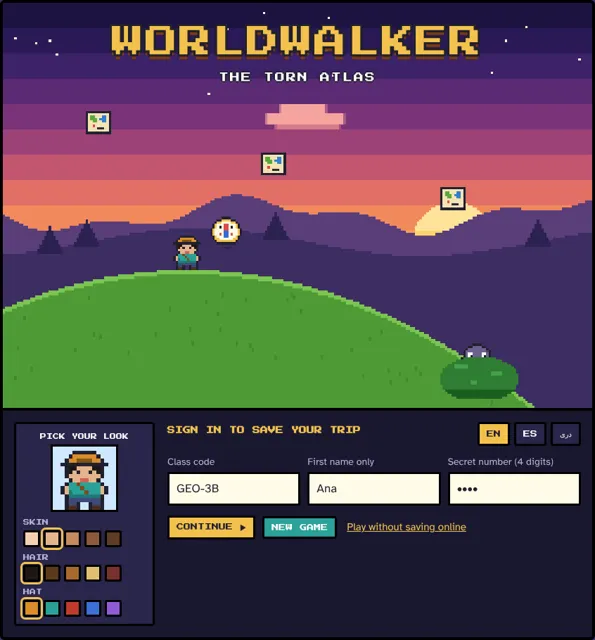
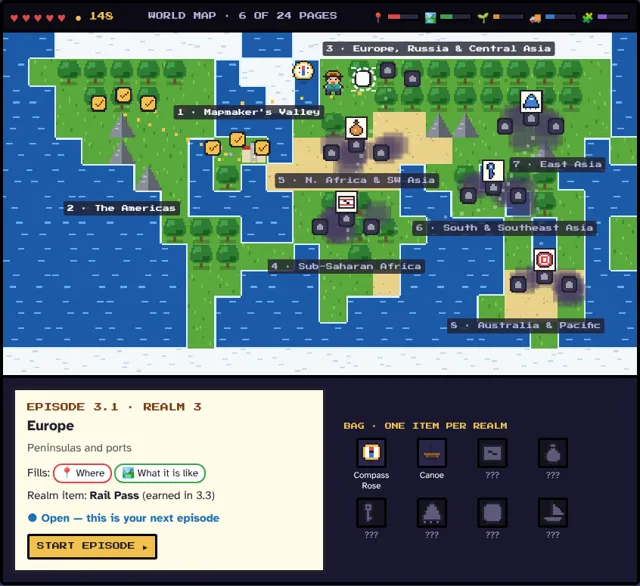
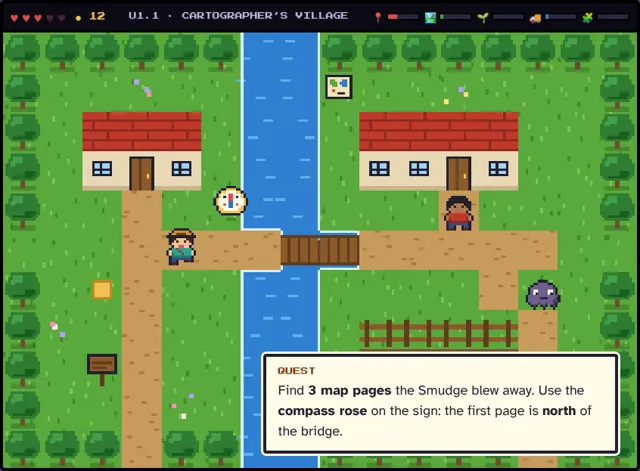
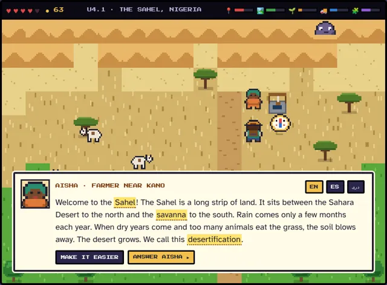
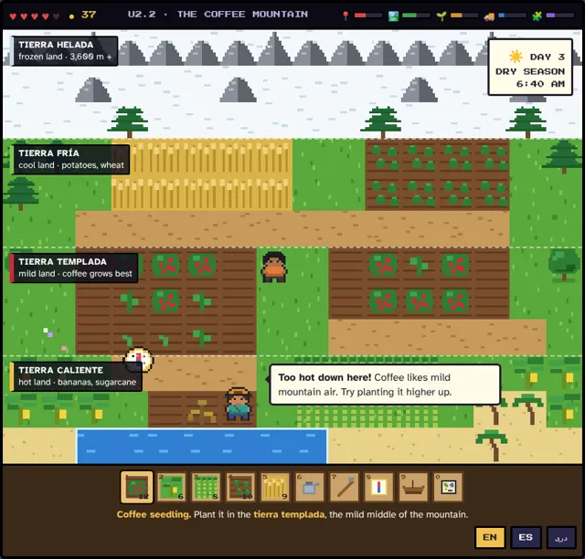
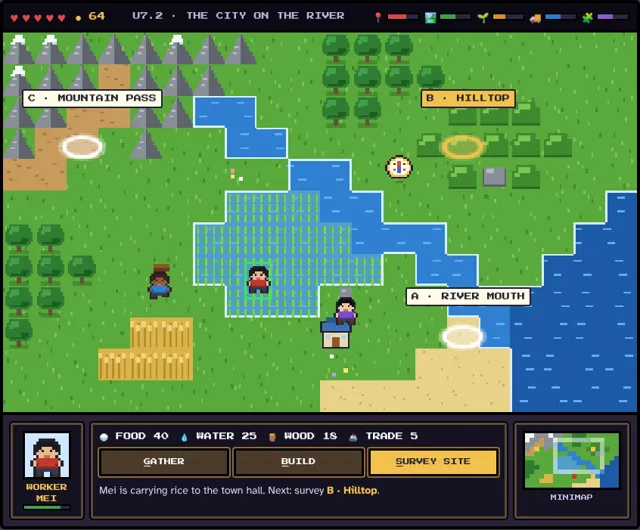
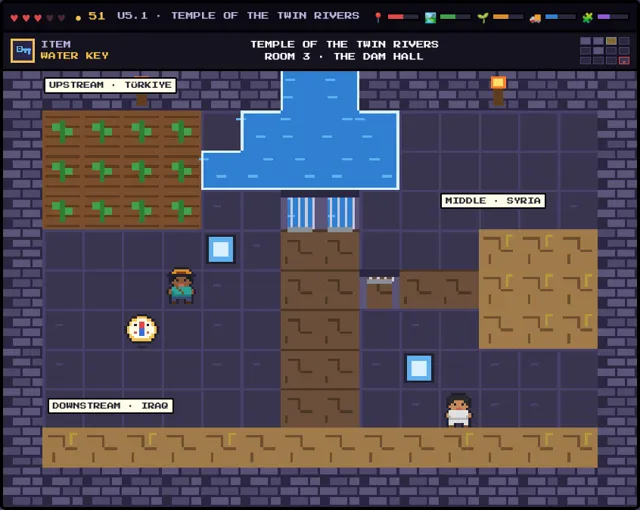
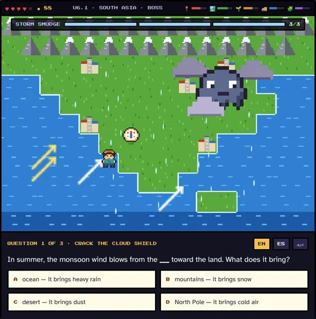
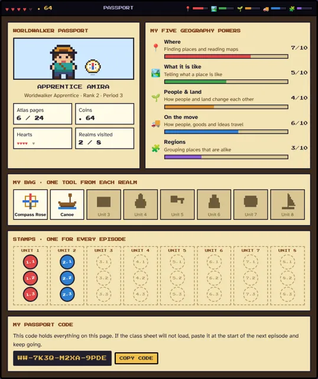
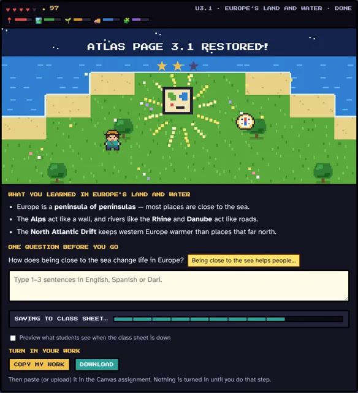

# WORLDWALKER — The Torn Atlas

A top-down geography RPG for **APA World Geography** (Alexandria City High School), in the spirit of the first Zelda, Stardew Valley and the first Warcraft. One episode per Canvas subunit (24 in all). The hero's progress saves to a class Google Sheet and carries from one Canvas page to the next.

- **[PLAN.md](PLAN.md)** — the full plan: story, the Five Themes stats, all 24 episodes, how it is built, how it saves, how it sits in Canvas, build phases, decisions still open.
- **[mockups/](mockups/index.html)** — ten screen mockups (open `mockups/index.html` in a browser, or the GitHub Pages link for this repo).
- **[apps-script/Code.gs](apps-script/Code.gs)** — draft of the Google Sheet save script (not yet tested in a real Sheet).

| | | |
|---|---|---|
|  **1 Title and sign-in** |  **2 World map** |  **3 Exploring** |
|  **4 Talk and read** |  **5 Mountain farm** |  **6 Found a city** |
|  **7 River temple** |  **8 Boss trial** |  **9 Passport** |
|  **10 Save and turn in** | | |

All characters and tiles are drawn in code; there are no picture files in the game itself.

### Tools in this repo
- `node shot.js mockups/*.html` — screenshots every mockup (desktop and phone width) into `shots/` and reports errors.
- `node thumbs.js` — remakes the gallery pictures (saves PNG; they were then shrunk to WebP).
