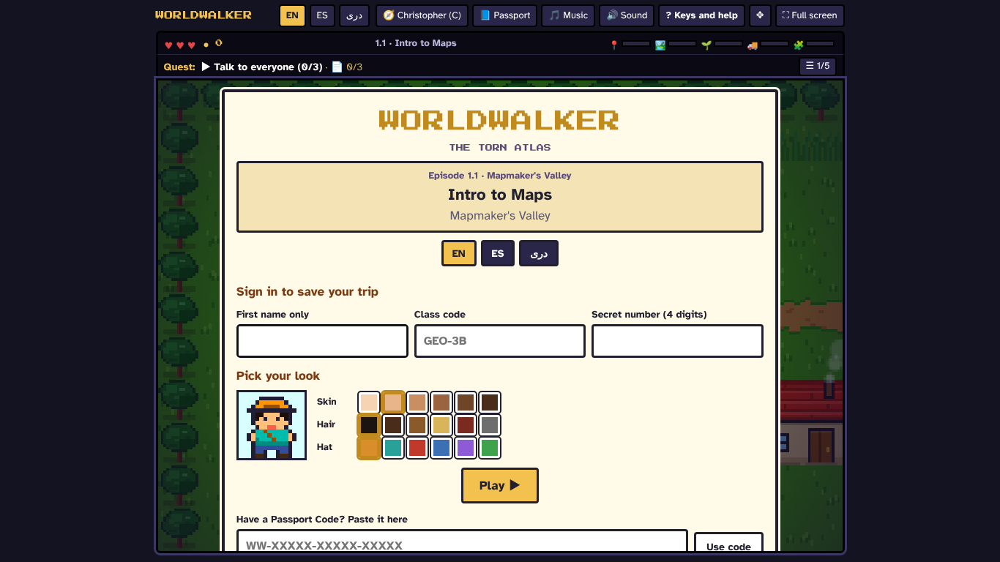
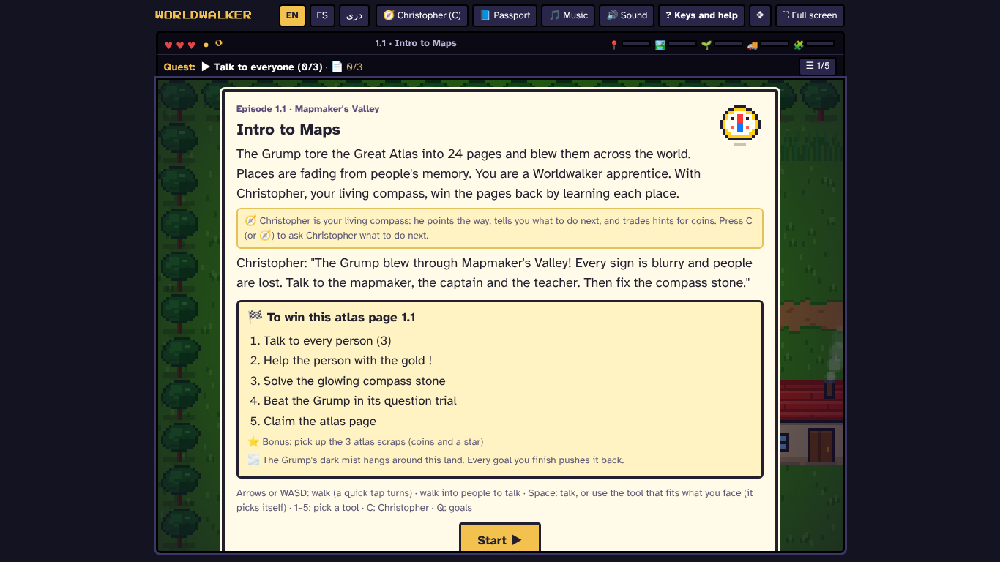
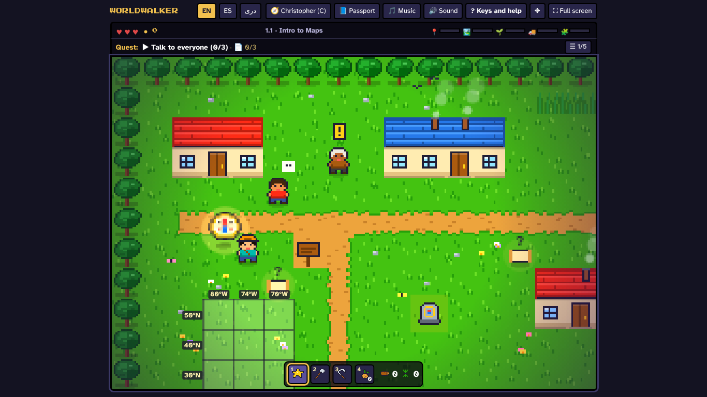
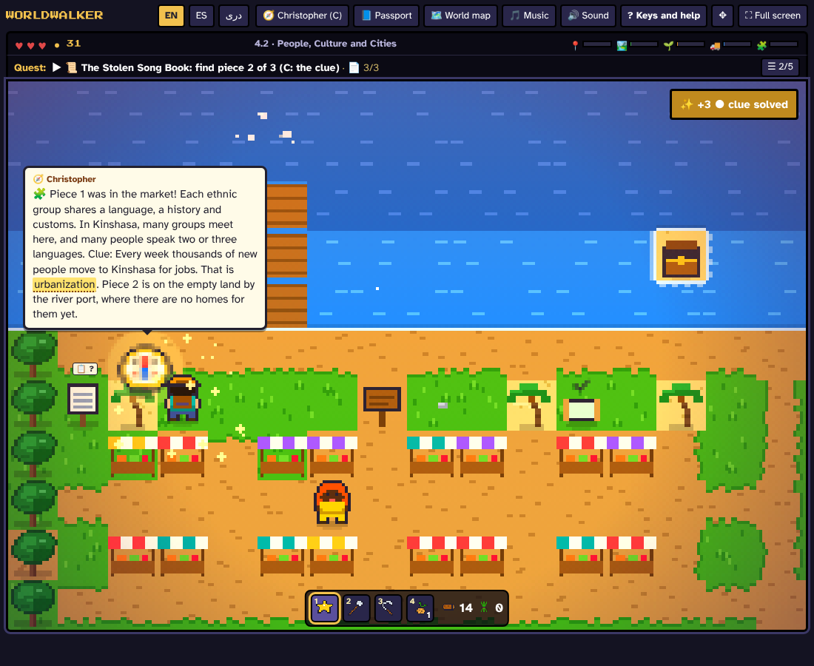
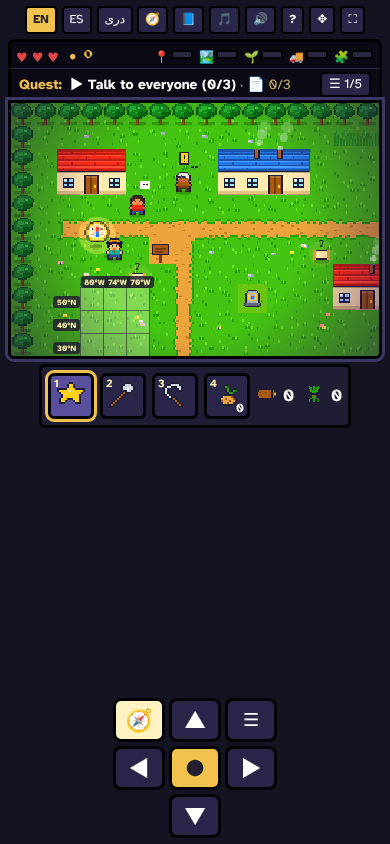
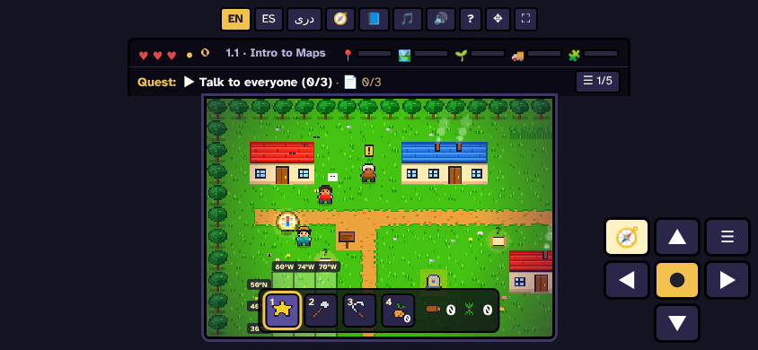
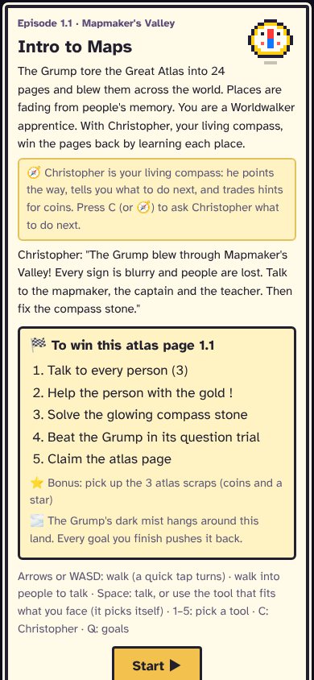
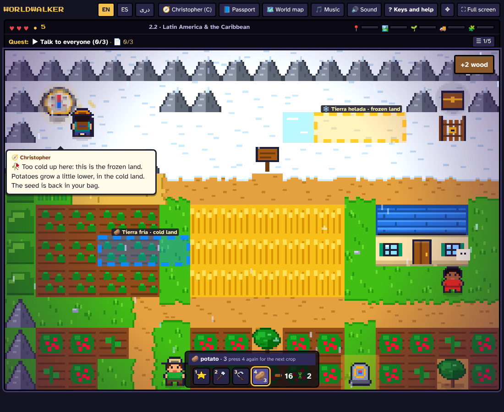
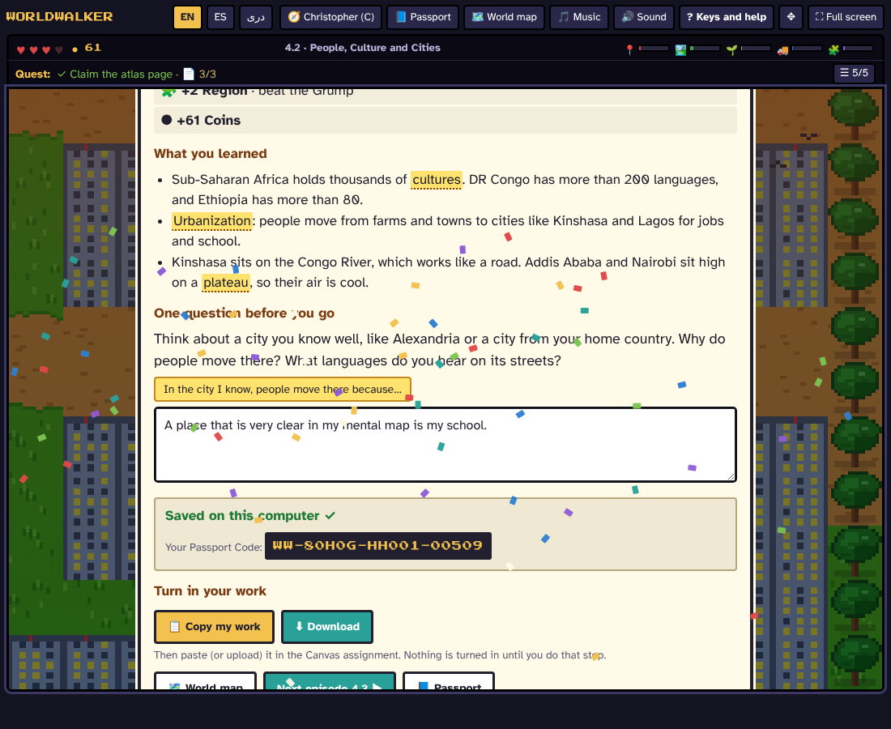

# Worldwalker · Playtest 3: playing it as a student

October 21, 2026 · branch `fun-pass-3` · no game changes yet

## How I played

I played as the four students from the handover:

| Student | Screen | How |
|---|---|---|
| **Jay**, distracted | Chromebook, 1366 × 768 | skips every box, stops after 20 s with nothing to do |
| **Fatima**, new to English | Chromebook, in Dari | reads slowly, taps the yellow words |
| **Diego**, phone only | 390 × 844, and turned sideways (844 × 390) | taps only |
| **Ms. K's class** | the Canvas frame, 654 × 820 | the one-file Canvas builds |

**Full plays, start to finish:**
- 1.1 (first episode)
- 4.2 (chase)
- 4.3 (trade and train)
- 2.2 (farm and trade)
- 3.2 (train)

All five played through with no errors. **First minutes:** all 24 episodes on all five screens (120 runs), with no errors.

**Two new test scripts** (they only measure, they change nothing):
- `node tests/playtest-words.js`: counts the reading in every episode and checks whether the right answer is the longest one.
- `node tests/playtest-start.js [1.1 …] [--idle]`: the first minutes on every screen. It counts screens, words and buttons before the first step, what a returning student sees, and whether anything happens after 5, 15 and 20 seconds of doing nothing. Screenshots go to `shots/playtest/`.

**About the times:** they are estimates from what I counted:
- 1.5 s for each button
- 10 s to type the name, class code and number
- 80 words a minute for a careful English learner

## The numbers

| | 1.1, first time | Every other episode | Coming back (any episode) |
|---|---|---|---|
| Screens before the first step | **5** (sign-in, opening card, Christopher × 3) | **2** (sign-in, opening card) | **2** (Continue, then the opening card) |
| Words before the first step | **309** | **210–245** | **about 200** (the opening card every time) |
| Time for Jay (skips everything) | **~18 s** | ~13 s | ~4 s |
| Time for a careful reader | **~4 min** | ~3 min | ~2.5 min |
| Target | under 10 s | under 10 s | under 10 s |

**Doing nothing in 1.1:** nothing happens at 5 s, 15 s, or 20 s. No bubble, no pointing, no sound.

**Text boxes:**
- **239 of 240** talk lines and opening lines are longer than 15 words. The longest are:
  - 57 words (Shirin, 5.2)
  - 55 words (Dr. Linh Nguyen, 8.3)
- Signs reach 52 words (8.1).
- In the chase episodes, a "piece found" message and the next clue appear in one bubble, which comes to about 60–70 words (picture 4).

**Guessing (the right answer is the longest one):**
- People's questions: **54 of 73 (74%)**
- Grump questions: **120 of 192 (63%)**
- By chance it would be 25–33%.
- In **98 of 265 questions (37%)**, the right answer is at least 30% longer than any other, so it is easy to spot.
- A wrong answer to a person costs nothing, and "Try again" is free. Jay can click through any person's question in 3 tries or fewer, and nothing rewards a first-try answer.

**Fatima (Dari):**
- Every screen I saw is in Dari and reads right to left (pictures 10 and the Dari talk box).
- The yellow words work.
- Afghan words are used.
- No problems found. There is no read-aloud yet.

**Ms. K's class (Canvas frame):** everything fits. The opening card fits without scrolling. No problems beyond the ones every screen has.

---

## Top 10 problems, ranked by how many students lose focus there

### 1. Too much reading before you can move. *Every student, every episode.*

**What happens:**
- In 1.1, a new student clicks through 5 screens and about 309 words before the first step.
- In every other episode, the opening card (about 200 words) comes back each time, even for a returning student. It has:
  - the story
  - a box on Christopher's job
  - his intro line
  - a list of 5 goals
  - a bonus line
  - a mist line
  - the key controls
- Jay clicks Start without reading any of it. Fatima needs about 3 minutes before she can walk.

 

**Fix:**
- **Coming back:** one big **Play** button with your name and class already filled in.
- **Opening card:** one sentence and one **Start**. The goal list moves to the Passport and the "Now" card (problem 3).
- **Christopher's welcome:** he says it while you walk (Part 2), with no Next buttons.

**Goal:** a returning student moves in about 3 seconds, a new one in under 10.

### 2. When a student stops, nothing happens. *Jay, and every student who gets stuck.*

**What happens:** in 1.1 I stood still for 20 seconds, and the game did nothing. A student who doesn't know about **C** / 🧭 has no way to learn what to do next. This is the moment Jay looks at his phone.

**Fix:**
- After about 15 seconds with no progress, Christopher flies to the next target by himself, for free, with a short chime and a ring on the spot. This is Part 2.

### 3. No single "go here" on the map. *Jay and Diego, on the very first screen.*

**What happens:** the first screen of 1.1 has about 7 things that catch the eye:
- the glowing Christopher
- a gold **!**
- a white speech mark
- two **?** notes
- the glowing compass stone
- a sign

The brightest thing (the stone) is locked. Walking into it says to come back later. Christopher glows the most, but he isn't something to walk to. The quest bar says "Talk to everyone (0/3)" but doesn't say who or where.

**Fix:**
- One clear marker (a bouncing arrow or a ring) on the current target only.
- Dim the stone until it is ready.
- On a Chromebook, a small **Now** card in the side space: the goal, who to find, and progress (for example "2 of 3 people").
- Christopher's flights (Part 2) point to the same target.

### 4. Text boxes are too long. *Fatima most, and Jay skips them all.*

**What happens:**
- Almost every talk line is over 15 words.
- The chase bubbles join "piece found" and the next clue into one block of about 70 words (4.2, picture).
- Signs reach 52 words.
- Because Jay skips everything, he misses the one clue he needed and wanders.

**Fix:**
- At most about 15 words per box. Split long lines into two short ones.
- The key fact in **bold** or yellow.
- Show "piece found" and "next clue" as two separate bubbles.
- A 🔊 button that reads the box aloud. Dari voices are often missing on Chromebooks, so we need to check on a real one.
- Have `tools/check.js` warn about any line over 15 words.

### 5. Answers can be guessed. *Jay.*

**What happens:** the right answer is the longest one 74% of the time for people's questions and 63% for Grump questions. Jay's "click the longest" trick works most of the time. A miss on a person costs nothing, so he never has to read.

**Fix:**
- Even out answer lengths in the episode files (the three languages together), starting with the 98 questions where it is easy to spot.
- Have `tools/check.js` warn when the right answer is the longest by a lot.
- Add a visible **"First try!"** reward (a coin, a sound, and Christopher spins) and a streak counter, so reading pays off.
- Keep "Try again" free (cozy rule).

### 6. On a phone, the map is small and the buttons are tiny. *Diego.*

**What happens:**
- **Upright (390 × 844):**
  - The map is about 370 × 255 pixels, about a third of the screen.
  - There is an empty gap of about 300 pixels between the tool bar and the arrow pad.
  - The 10 buttons along the top are 23–37 pixels wide, below the usual 44-pixel size for a thumb.
  - The opening card tells a phone player "Arrows or WASD… Space…" instead of the touch controls.
- **Sideways:** the tool bar covers the bottom row of the map (the 30°N row of the 1.1 grid).

  

**Fix:**
- **Upright:** let the map grow into the empty space, and move the arrow pad up under it.
- **Top bar:** put Music, Sound and Keys into one ⚙ and make the rest at least 44 pixels.
- **Opening card:** show the touch controls on touch screens.
- **Sideways:** keep the tool bar off the map.

### 7. Christopher sits on the hero and isn't a guide. *Everyone.*

**What happens:**
- He trails one tile behind and often sits right on the hero's head (2.2 farm, 4.3 trade), hiding the hero.
- He only acts when asked, so most students never learn he can help.

**Fix:** this is Part 2. He becomes a small flying spirit that:
- orbits beside the hero, never on top
- flies to the target and circles it
- has a color that says what kind of thing it is (gold for a goal, green for something to pick up or do, blue for a secret, red for danger)

### 8. "Turn in your work" is below the fold. *Jay. If he doesn't turn it in, he gets no credit.*

**What happens:**
- On the finish screen, **Copy my work** sits under the rewards, the "What you learned" list and the reflection question.
- On a Chromebook you have to scroll to reach it.
- The confetti falls on top of the reflection text while the student is trying to type.

**Fix:**
- Put the reflection box and **Copy my work** / **Download** at the top.
- Put the rewards and "What you learned" under them.
- Keep the confetti out of the panel (or stop it when the student starts typing).

### 9. The sign-in screen has too much on it. *New students in 1.1.*

**What happens:**
- 43 things to click:
  - 3 boxes
  - 18 color squares
  - 3 language buttons
  - the Passport Code box
  - the top bar
- At 1366 × 768, the Play button sits under the look picker, and the Passport Code row is cut off at the bottom.
- Nothing says "start here."

**Fix:**
- Put **Play** right under the three boxes.
- Make "pick your look" a small step after Play, or put it in the Passport (it is saved either way).
- Fold the Passport Code into a "Have a code?" link.

### 10. The top bar is crowded and the 5 theme bars have no labels. *Jay and Fatima.*

**What happens:**
- 10 buttons across the top (11 once the World map button shows up).
- 5 skinny theme bars with only small icons, so a student can't tell what they track.
- The quest line is small for the most important thing on screen.

**Fix:**
- Put Music, Sound and Keys in one ⚙.
- Make the quest line bigger.
- Give each theme bar a one-word label, or show its name when tapped (in all three languages).

---

## Smaller things I noticed

- **Compass stone panel (2.2):** the cards are numbered twice ("1. 📦 1. Bananas").
- **Panels opening:** for a split second while a panel fades in, the tool bar shows on top of it. It settles correctly; I checked the layers after the fade.
- **Wrong-way hints work well:** planting a potato too high says why and gives the seed back (2.2). The chase says why a wrong place is wrong (4.2). The train ride in 3.2 and 4.3 feels good.

## What I checked from the starting backlog

| Backlog item | Confirmed? | Where it ranks |
|---|---|---|
| Moving in under 10 seconds | Yes, 13–18 s today, 4 min for a careful reader | **1** |
| Always one obvious "go here" | Yes | **2, 3** |
| Half the reading, 🔊 read aloud | Yes, 239 of 240 boxes over 15 words | **4** |
| Questions you can't guess | Yes, 66% guessable; choices are already shuffled | **5** |
| Game-like talk boxes, keys 1/2/3 | Part of it: the talk box already has a portrait and name plate | goes with 4 and 5 |
| Cleaner top bar | Yes | **10** |
| "Now" card in the side space | Yes | part of **3** |
| Finish screen: turn in at the top | Yes | **8** |
| Come-back hooks (hats, top-5 board, speed badge) | Not a problem a student hits; a new feature | after the top 10 |
| Shorter, funnier lines and names | Goes with 4 | with **4** |
| *(new)* Phone layout | | **6** |
| *(new)* Christopher on the hero | | **7** (Part 2) |
| *(new)* Sign-in screen | | **9** |

## Still open (for you)

- Paste the updated `apps-script/Code.gs` into the Google Sheet's script and redeploy.
- Check whether the real Canvas page adds its own header inside the 820-pixel frame.
- All my testing used a browser set up to act like a Chromebook or phone. A real school Chromebook and a real phone are still needed, especially to check whether a Dari voice exists for read-aloud.

## After the fixes (October 21, evening)

All ten problems have been worked on. Christopher's wings handled 2 and 7, and the other eight were fixed one by one. Every test passes:

- all 24 episodes play start to finish, both the website files and the Canvas files
- fit, keys, touch, phone, controls, stars, powers, Sheet, teacher, walk, look, maps, camp, music, and the new Christopher checks

The largest Canvas file is 405 KB, under the 430 KB limit. Re-measure with `node tests/playtest-start.js` and `node tests/playtest-words.js`, and run everything with `bash tools/run-all-tests.sh`.

| | Before | After |
|---|---|---|
| Screens before the first step, 1.1 first time | 5 (309 words) | 2 (sign-in, then a one-sentence card) |
| Screens before the first step, other episodes | 2 (210–245 words) | 2 (the opening card is one sentence) |
| A returning student | Continue, then a 200-word card | Continue, then a one-sentence card (~3 s) |
| Christopher's welcome | 3 bubbles with Next buttons, game paused | said while you walk (3 steps or a tap moves on) |
| 20 s of doing nothing | nothing happens | Christopher flies to the goal by himself after 15 s |
| Text boxes over 15 words | 239 of 240 | 0 of 343 |
| Right answer is the longest choice | 66% (37% clearly) | 11% (0% clearly) |

What changed for each problem:

1. **Faster start:** the opening card is one sentence and **Start**. Christopher says the episode's opening lines on the map while the student walks.
2. **When a student stops:** Christopher flies to the next goal by himself after about 15 s, for free (Part 2).
3. **One "go here":**
   - A gold arrow bobs over the goal right now, or waits at the screen edge pointing the way.
   - The compass stone rests, dim and with a small lock, until it's ready.
   - On a Chromebook, a **Now** card beside the map shows the goal, where to go, and the list.
4. **Shorter boxes:**
   - The episode text is rewritten in English, Spanish and Dari, with no fact a question needs left out (see `docs/READING-PASS.md`).
   - Chase messages are two short bubbles.
   - A 🔊 button reads aloud on computers that have a voice for the language. It hides where there is no Dari voice.
   - `node tools/check.js --reading` keeps it that way.
5. **Answers you can't guess:**
   - Choices are close in length, and the right one is never clearly the longest.
   - A right answer on the first try gives **⚡ First try! +1 ●** and a 🔥 streak.
   - "Try again" stays free.
6. **Phone:**
   - Bigger top buttons and a bigger arrow pad.
   - Turned sideways, the tool bar stands beside the map, not on it.
   - The map can't get wider than the phone without cutting part of it off, so it stays full width.
7. **Christopher on the hero:** he flies beside the hero and never covers him (Part 2).
8. **Finish screen:**
   - The reflection box and **Copy my work** / **Download** come first, then the rewards.
   - The confetti falls behind the panel.
9. **Sign-in:** **Play** sits right under the three boxes. "Pick your look" and "Have a Passport Code?" fold away below it.
10. **Top bar:**
    - Music, Sound, Keys and help, the arrow pad and Full screen are in one **⚙ Settings** menu.
    - The quest line is bigger.
    - The theme bars have word labels (tap one for its name and number).

One thing to know about answers: with lengths evened out, the right answer is now most often a middle-length choice. The lengths are so close that a student can't see a pattern by eye, but a later pass could mix this up more.

Screenshots after the fixes are in `docs/playtest-3/after/`.

## Next

Gabriel checks the branch `fun-pass-3` and says "merge" when he is happy. The "Still open" items above are still open.
